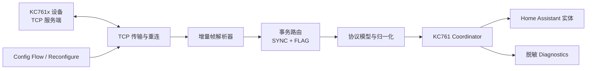
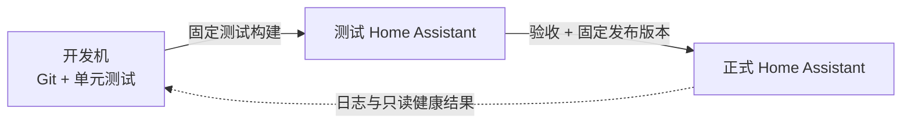

# KC761x Home Assistant HACS 集成功能架构

状态：已接受的初始架构基线

日期：2026-08-10

适用阶段：协议实现、首版只读集成、测试环境验证、首个 HACS 发布

## 1. 目标

本项目把 KC761x 的局域网通信能力映射为稳定、可诊断、可升级的 Home Assistant 设备集成。设计目标按优先级排列如下：

1. 在不改变辐射计运行状态的前提下，可靠读取实时状态和设备信息。
2. 将辐射数据、环境数据和累计统计映射为语义稳定的 Home Assistant 实体。
3. 正确处理 TCP 流分片、粘包、自动上传帧、查询应答交错和断线重连。
4. 以真实设备证据约束协议解释，不能确认的端序、单位和字段不进入正式实体。
5. 保持 HACS 单集成仓库结构，同时使协议层能脱离 Home Assistant 独立测试。
6. 在测试环境完成协议、生命周期、升级和回滚验证后，再部署到正式环境。

## 2. 非目标

首版明确不做以下工作：

- 不连接科创云，不实现云端 32 字节校验。
- 不实现串口。官方上位机虽然显示“串口”选项，但编程手册没有提供串口接口定义。
- 不实现 BLE。手册缺少服务 UUID，且还需要验证 HA 主机蓝牙能力、MTU 协商和通知丢包恢复。
- 不自动修改设备时间、传感器选择、音量、灯光或自动上传状态。
- 不写入校准参数，不清除谱图、剂量曲线或累计剂量。
- 不把 1024/2048/4096 道完整谱图保存为普通实体状态或属性。
- 不在正式环境进行协议探索、抓包、压力测试或未固定版本的安装。

这些能力可以在证据充分后进入后续阶段，但不得绕过测试门禁。

## 3. 证据分级

架构中的判断必须标明证据强度：

| 等级 | 含义 | 可用于什么 |
| --- | --- | --- |
| M - 手册确认 | 编程手册明确给出字段、长度、指令或行为 | 只读解析设计；写操作仍需实机验证 |
| U - 上位机观察 | 官方上位机截图显示了功能、标签或默认值 | UI/实体候选；不能单独证明线协议 |
| L - 实机确认 | 测试设备抓包、应答和读回已验证 | 正式解码、兼容性声明和受控写入 |
| I - 架构推断 | 为实现完整性做出的保守设计 | 必须通过测试后才能提升为 L |

当前资料只达到 M/U。所有涉及端序、浮点格式、累计单位、默认端口和谱图完成条件的内容仍需 L 级证据。

## 4. 总体结构

每个配置条目对应一台物理辐射计和一条持久 TCP 连接。协议层不依赖 Home Assistant；Coordinator 独占连接生命周期和设备访问顺序；实体只从 Coordinator 的内存快照读取数据，不直接发起网络 I/O。

## 5. 仓库与模块边界

HACS 要求一个仓库只管理一个 `custom_components` 集成，且运行所需文件位于集成目录内。因此采用单仓库、内部分层，而不是首版拆成两个发布包。

| 层 | 规划位置 | 职责 | 禁止事项 |
| --- | --- | --- | --- |
| 协议值对象 | `protocol/models.py` | 不可变状态、设备信息、校准和谱图片段模型 | 不引用 HA 类型 |
| 编解码 | `protocol/codec.py` | 数值、位字段、命令和响应编解码 | 不做 socket I/O |
| 帧解析 | `protocol/framing.py` | TCP 缓冲、长度校验、重同步、连续帧拆分 | 不解释 HA 实体语义 |
| 客户端 | `protocol/client.py` | SYNC 分配、请求/应答匹配、推送路由、超时 | 不创建 HA 实体 |
| 传输 | `protocol/transport.py` | TCP 连接、读写、关闭与重连 | 不持有业务状态 |
| 协调器 | `coordinator.py` | 轮询节奏、缓存、可用性、生命周期、写锁 | 不把大数组写入 HA state |
| 配置 | `config_flow.py` | 连接预检、DEVICE_ID 唯一性、重新配置 | 不以 IP 作为 unique ID |
| 平台 | `sensor.py` 等 | 实体描述与状态呈现 | 属性 getter 不做 I/O |
| 诊断 | `diagnostics.py` | 脱敏状态与连接统计 | 不默认包含原始帧、主机或完整 ID |

协议层先保留在 `custom_components/kc761/protocol/` 内。只有在出现第二个独立消费者、版本边界稳定且发布收益大于双版本成本时，才评估拆出 PyPI 包。

## 6. 传输范围

| 传输 | 手册状态 | 首版决定 | 理由 |
| --- | --- | --- | --- |
| 局域网 TCP | 设备为服务端 | 支持 | 本地、无需云认证，官方上位机已有网络入口 |
| BLE 5.0 GATT | 设备为服务端，类似 NUS | 延后 | 设备在线/广播状态尚未确认；已有阴性扫描结果不具备证明力，服务 UUID 仍缺少实测证据；还需验证 MTU、丢包和 HA 蓝牙 |
| 云 TCP | 设备为客户端 | 排除 | 明文、追加校验、自建云目前不支持 |
| 串口 | 仅截图出现 | 排除 | 编程手册没有串口定义或参数 |

网络 Config Flow 接收 `host` 和 `port`。截图显示端口 `7601`，因此 UI 可暂以 7601 作为预填值，但在实机确认前必须把它标记为“上位机观察值”，不能宣称为手册规定的固定端口。

## 7. TCP 连接与帧解析

### 7.1 连接模型

- 每个配置条目只创建一个连接管理器和一个活动 TCP 连接。
- 初始连接、重新配置、周期读取、按需操作、卸载和关闭统一由 Coordinator 管理。
- 同一连接上的所有写入串行化；不得由多个实体并行写 socket。
- 断线采用有上限的指数退避并加入抖动；重新连通后先重新读取设备信息和实时状态。
- Home Assistant 卸载配置条目时，必须取消读循环、解决或取消待处理请求，再关闭 writer；关闭路径必须幂等。

### 7.2 TCP 是字节流

不能把一次 `read()` 当成一个协议包。增量解析器必须支持：

- 一个帧被拆到多次读取；
- 多个帧粘在一次读取；
- `STATUS_DATA` 后紧跟 `STREAM_DATA`；
- 查询应答与设备自动上传交错；
- 断线前遗留半帧；
- 遇到未知标志或不合理长度时有界重同步，而不是无限增长缓冲区。

对设备上行帧，第二字节是已知标志，第三至第四字节是 `BAG_LEN`。在端序实机确认前，解析器测试同时保留原始字节和解释结果，不能仅凭命名假设为小端。

### 7.3 事务路由

- 主动请求使用 0x00-0xFF 循环的 `SYNC`，不得复用仍在等待中的值。
- 普通应答至少按“SYNC + 预期 FLAG”匹配。
- 写操作 ACK 还必须校验 ACK 内回显的命令字节。
- 自动上传标志 `0xA1`、`0xA3`、`0xA4` 作为非请求数据单独分流。
- 谱图请求可能返回多个同 SYNC 的 `MC_DATA` 片段，按 `MC_DATA_SOURCE` 与 `MC_OFFSET` 重组。
- 超时后不得把迟到帧错误交给新的同 SYNC 请求；需要冷却窗口或事务代次。

## 8. 数据获取策略

首版采用“轮询为基线、被动接受推送”的混合策略：

| 数据 | 默认节奏 | 依据与处理 |
| --- | --- | --- |
| 实时状态 | 5 秒 | HA 侧适度轮询，控制 Recorder 写入量；可在 5-60 秒范围配置 |
| 设备信息与累计统计 | 60 秒 | 手册建议不常访问，例如 1 分钟 |
| 校准数据 | 首次按需或诊断操作 | 不需要周期读取；首版不形成写入口 |
| 完整谱图 | 默认不轮询 | 数据量大，完成条件仍需实机确认 |
| 自动上传帧 | 随到随解析 | 若设备原本已开启则更新内存快照，但集成不修改该设置 |

Coordinator 的 5 秒周期中只发一次实时状态请求，并在设备信息缓存过期时附加设备信息请求。实体统一消费一个不可变快照，避免同一轮更新出现跨时刻字段。

官方手册说明自动上传可以每秒发送，并在高计数率时从脉冲流切换为谱模式。首版不能依赖其格式稳定性，也不能为了降低延迟主动设置 `AUTO_UPLOAD_STATUS`，因为该设置会影响其它同时连接的上位机。

## 9. Config Flow 与配置条目

### 9.1 首次配置

1. 用户输入主机或域名、端口。
2. 建立有界超时的 TCP 连接。
3. 发送 `CMD_GET_DEVICE_INFO`，验证帧结构、支持的型号和非空 `DEVICE_ID`。
4. 发送 `CMD_GET_STA`，验证状态包长度和基本数值合法性。
5. 用设备返回的 `DEVICE_ID` 设置 Config Entry unique ID。
6. 如果 unique ID 已存在，终止新增流程并提示使用“重新配置”。
7. 创建条目后由 Coordinator 重新建立正式连接，不复用 Config Flow 的临时资源。

不允许使用 IP、端口、自定义名称或可变主机名作为 unique ID。`DEVICE_ID` 解析时去除 NUL 填充并保留原始稳定文本；若格式与手册示例不同但为非空可打印字符串，记录兼容性诊断而不是擅自改写。

### 9.2 重新配置

重新配置仅允许修改主机和端口，并必须连接新地址、再次读取 `DEVICE_ID`、确认它与原配置条目一致后才更新并重新加载。这样可处理 DHCP 地址变化，同时避免把条目悄悄指向另一台辐射计。

### 9.3 Options Flow

首版可配置项：

- 实时状态轮询间隔：默认 5 秒，范围 5-60 秒。
- 设备信息轮询间隔：默认 60 秒，范围 60-3600 秒。
- 是否启用默认关闭的高频原始读数实体。
- 是否允许实验性谱图按需功能；默认关闭，只有协议证据达到 L 级后显示。

设备地址属于重新配置数据，不放在 Options Flow。首版没有认证，因此不实现 reauth。

## 10. 设备注册与实体生命周期

- 一台物理 KC761x 注册为一个 HA Device。
- Device identifier 使用 `(DOMAIN, DEVICE_ID)`。
- 型号来自 `DEVICE_MODEL`；硬件版本来自 `HW_VER`；主固件版本来自 `FW_VER`。
- 协处理器固件、各通道传感器型号作为诊断信息；是否放入实体由实体模型文档决定。
- 不存在的通道不创建测量实体；存在但当前未运行、返回 `-1` 的通道实体保留但状态为 `unknown`，避免实体反复增删。
- 首次设备信息成功后创建实体；后续型号或传感器清单变化只触发受控重载，不在每次轮询动态抖动实体集合。

设备制造商名称在现有资料中没有一个足够明确、适合 Device Registry 的标准字符串，保持待确认，不能仅把手册印行方“科新社”当作制造商。

## 11. 可用性与错误模型

错误分为四类：

| 类型 | 示例 | HA 行为 |
| --- | --- | --- |
| 连接错误 | 拒绝、超时、EOF | 当前快照保留，实体标为不可用，后台重连 |
| 帧错误 | 长度异常、未知 FLAG、缓冲失步 | 丢弃有界字节并计数；连续错误触发重连 |
| 数据错误 | NaN、无穷、非法百分比、倍率 0 | 拒绝该字段或整帧，记录限频警告 |
| 设备拒绝 | ACK STATUS=失败 | 操作失败，不乐观更新，随后读回 |

每次成功状态轮询恢复可用性。不得用“TCP 端口可连接”代替设备协议健康；必须收到并成功解析预期应答。

## 12. 读写安全模型

### 12.1 首版

首版只发送三个只读命令候选：

- `0x53` 读取实时状态；
- `0x54` 读取设备信息；
- `0x52` 读取谱图，仅在实验性功能启用且完成实机验证后开放。

校准读取 `0x55` 可以用于开发诊断，但默认不周期发送，也不承诺形成正式实体。

### 12.2 后续可控写入

任何写功能进入产品前必须同时满足：

1. 只在测试环境完成实机抓包和读回验证；
2. 用户在 Options Flow 显式启用“设备控制”；
3. 只允许预定义字段和值域，不接受任意原始十六进制；
4. 采用读-改-写或 0xFF 跳过机制，避免覆盖无关字段；
5. 校验 SYNC、ACK 标志、状态和回显命令；
6. 立即重新读取状态并确认生效；
7. 操作失败时不更新 HA 状态；
8. 与轮询、重连和其它写操作共享同一锁。

校准写入 `0x64` 和清除统计 `0x66` 属于高风险功能，不因普通“设备控制”开关自动启用。它们需要单独的产品决策、强确认和完整备份/恢复方案。

## 13. 谱图架构

完整谱图不适合普通 Home Assistant state：数组可能包含数千个整数，会放大状态机、WebSocket 和 Recorder 负担，也没有原生谱图设备类。

首版策略：

- 协议层支持片段解析和测试，但 HA 平台不创建“完整谱图”传感器。
- 在实机确认总道数和传输完成条件后，提供按需动作 `kc761.capture_spectrum` 的设计评审。
- 按需动作返回瞬时响应，不把完整数组持久化为实体属性。
- 若需要官方上位机式交互谱图，后续单独设计 Lovelace 卡片和有界 WebSocket API，不与基础 HACS 集成首版绑定。
- 可以评估派生的峰值道址、峰值能量、总计数等小型指标，但必须先验证能量刻度和统计语义。

## 14. 诊断与隐私

默认诊断允许包含：

- 集成版本、配置版本和启用选项；
- 型号、硬件/固件版本、传感器类型；
- 最近成功时间、连续失败数、重连次数、协议错误计数；
- 最近帧类型、声明长度和解析结果摘要；
- 轮询间隔和当前连接状态。

默认必须脱敏或排除：

- 主机、端口以外的网络拓扑信息；
- 完整 `DEVICE_ID`；
- 原始帧和可能包含唯一 ID 的 payload；
- 完整谱图、长期测量序列；
- Home Assistant 密钥、SSH 信息或本地路径中的凭据。

原始协议跟踪只能通过显式调试选项短时开启，设置大小上限和自动停止，并只在测试环境使用。

## 15. 性能与 Recorder

- 默认只启用平滑值；上一秒原始值默认关闭，避免相似实体和高频历史同时写入。
- 默认轮询不低于 5 秒；用户降低间隔前应看到 Recorder 体积提示。
- Coordinator 在值未变化时可避免无意义的监听器通知，但辐射测量通常会变化，不能依赖此项消除全部写入。
- 累计量只有在单位确认后才启用统计状态类。
- 完整谱图、脉冲流和通信原始帧永不进入 Recorder。

## 16. 兼容性策略

- 编程手册覆盖 KC761A/B/C/CN，并标为软件版本 V1.8。
- 上位机截图提示某些 KC761 固件需 V1.81 或更高，属于待实机确认的版本门槛。
- Config Flow 不只按型号字符串放行，还要验证实际响应长度和关键字段。
- 未知但结构兼容的 `DEVICE_MODEL` 不应立即崩溃；以“未知型号”加载只读诊断或明确拒绝，由测试证据决定。
- 任何因固件版本产生的帧差异都通过协议 fixture 和能力标志表达，禁止在实体层散布版本判断。

## 17. 部署拓扑

测试环境负责真实设备通信、断线、重启、重载、升级和回滚。正式环境只安装已经在测试环境通过相同 HA 版本或明确兼容版本验证的 release，不直接安装开发工作区内容。

## 18. 参考规范

- Home Assistant 建议同一设备数据由 `DataUpdateCoordinator` 协调获取，实体属性只从内存返回：[Fetching data](https://developers.home-assistant.io/docs/integration_fetching_data/)
- Config Entry 应使用稳定设备标识，IP 不可作为 unique ID，并为地址变化提供 reconfigure：[Config flow](https://developers.home-assistant.io/docs/core/integration/config_flow/)
- 测量值和累计值需选择合适的 state class：[Sensor entity](https://developers.home-assistant.io/docs/core/entity/sensor/)
- HACS 集成仓库应只包含一个受管理集成，运行文件位于 `custom_components/<domain>`：[HACS integrations](https://hacs.xyz/docs/publish/integration/)
