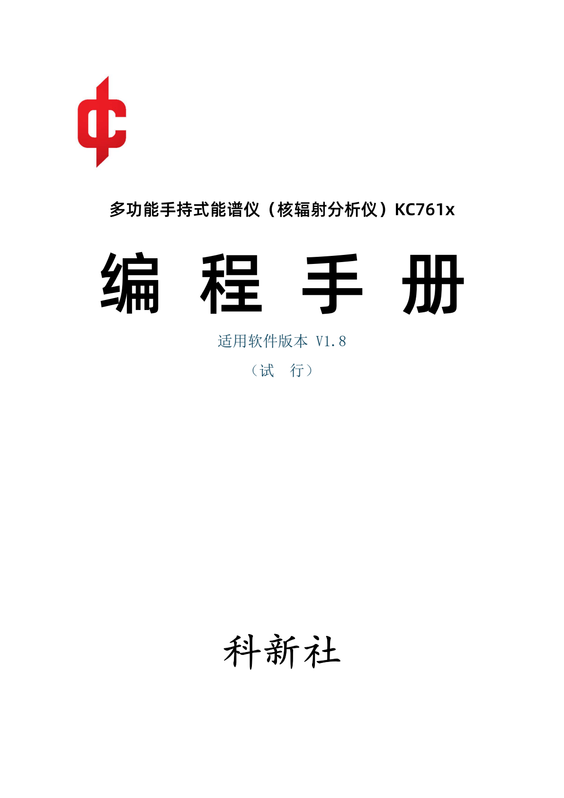

# 多功能手持式能谱仪（核辐射分析仪）KC761x 编程手册

- 适用软件版本：V1.8
- 状态：试行
- 印行：科新社
- 原 PDF：KC761x编程手册.pdf

> 本文件按原手册 20 页完整转写，便于检索、引用和代码审查。协议字段、表格、位定义、公式、示例及原文中的矛盾均予以保留。封面与封底作为图片保留，其余表格和图示转换为原生 Markdown。
>
> 原手册若出现字段名与规定值不一致，本转写不擅自修正，并在相应位置标注“原文如此”。

## 内容提要

本手册介绍了 KC761x 型便携式核辐射分析仪的通信功能和通信规约，主要供从事 KC761x 二次开发的工程技术人员阅读。

## 开发与出版信息

- 总工程师：陶乐
- 工程师：李云、袁心治、刘虎
- 顾问专家：石丛玮、徐诺、杨天皓、柯巍
- 著述者：陶乐（科创研究院仪表研究所）
- 印行者：科新社
- 通信本社：028-86691700
- 2025 年 5 月第一版
- 开本：841×1189 1/64
- 2025 年 5 月第一次印刷
- 印张：0.2
- 印数：0-100
- 字数：20 千字

## 目录

1. [适用范围](#一适用范围)
2. [接口定义](#二接口定义)
   - [2.1 以太网接口](#21-以太网接口)
   - [2.2 低功耗蓝牙接口](#22-低功耗蓝牙接口)
   - [2.3 最大包长](#23-最大包长)
   - [2.4 云连接校验](#24-云连接校验)
3. [通信协议](#三通信协议)
   - [3.1 读取谱图数据](#31-读取谱图数据)
   - [3.2 读取与设置实时状态](#32-读取与设置实时状态)
   - [3.3 自动数据上传](#33-自动数据上传)
   - [3.4 读取设备信息](#34-读取设备信息)
   - [3.5 设置设备时间](#35-设置设备时间)
   - [3.6 读取与写入校准数据](#36-读取与写入校准数据)
   - [3.7 清除辐射统计数据](#37-清除辐射统计数据)

## 一、适用范围

本手册适用于 KC761A、KC761B、KC761C、KC761CN，除另有说明外，通用于低功耗蓝牙（BLE）和以太网（局域网），连接对象支持科创云。三种通信方式可以同时使用，仪器执行所有到达的指令。

## 二、接口定义

### 2.1 以太网接口

即 RJ45 接口，支持 PoE 供电：IEEE 802.3af（PoE）、IEEE 802.3at（PoE+）。通过此接口，可以建立局域网连接，也可以连接到科创云。该接口使用 TCP/IP 协议。

当使用局域网连接时，辐射计作为服务端。当使用云连接时，辐射计作为客户端。

### 2.2 低功耗蓝牙接口

BLE 5.0，GATT 协议。辐射计作为服务端。与 NUS（Nordic UART Service）协议类似，使用两个 GATT 特征，分别模拟串口的收、发。

| 项目 | 值 |
| --- | --- |
| RX 接口 UUID | 6E400002-B5A3-F393-E0A9-E50E24DCCA9E |
| RX 接口属性 | write（上位机向辐射计写入，在 GATT 协议层面会确认写入） |
| TX 接口 UUID | 6E400003-B5A3-F393-E0A9-E50E24DCCA9E |
| TX 接口属性 | notify（上位机订阅此特征，辐射计单向通知上位机，无需上位机确认） |

蓝牙协议的制定原则是尽量降低辐射计的功耗与通信延迟，这要求辐射计的蓝牙硬件尽量处于休眠状态，仅在发送数据、维持连接时唤醒。大多数场景下，辐射计使用“通知”方式将数据推送到上位机，发送完成后立即休眠，无需等待上位机响应。这意味着有较高的丢包率，但在本辐射计的应用场景中的影响可以忽略，因为后续未丢包的传输可以完成数据同步。所有数据在辐射计都有备份，可以通过重复读取补齐。

为快速同步数据，当上位机订阅蓝牙 TX 通道后，辐射计默认开启蓝牙的自动上传，并且在首帧以谱模式推送数据。

### 2.3 最大包长

BLE 的 MTU 由通信双方协商获得，受上位机平台限制，可能出现多种最大通信包长（KC761x 最大 MTU=517）。MTU 包含蓝牙协议的报头，实际可用的最大包长为 MTU-3。如果需要传输尺寸稍大的数据（多道图、剂量-时间曲线），就需要将数据截成多段，造成蓝牙频繁发包。为降低蓝牙功耗、降低通信开销，规定以下几种最大包长：

| 最大包长 | 适用范围 | 条件 |
| ---: | --- | --- |
| 1072 B | 仅用于以太网协议 | - |
| 504 B | 仅用于 BLE，适用于较新的设备版本 | 通信双方 MTU ≥ 507 B |
| 182 B | 仅用于 BLE，适用于较老的设备版本，或新设备请求大 MTU 失败 | MTU ≥ 185 B |

大部分数据包尺寸较小，达不到最低一档（182 B）的限制，此时无论最大包长是多少，在上位机看来没有任何区别。通信中，辐射计会自行选择当前可用的最大包长，上位机无法干预。上位机需要解析数据包前部的标志码，从而知晓数据包类型，并根据约定的结构对数据包进行正确解码。

对于蓝牙上位机，应当尽量申请 MTU ≥ 507，此时辐射计将采用较长的包长，有利于降低功耗和通信延迟。如果使用的 MTU < 185，辐射计不会回应指令，上位机应当告知用户“蓝牙版本过低”。对于常见的蓝牙库，建立连接时可能默认采用较小的 MTU，应特别指定。

### 2.4 云连接校验

为降低开发难度、简化通信流程，数据是明文传输的。为了避免攻击者向科创云灌输假数据，与蓝牙/局域网相比，云连接增加了校验码。

1. 辐射计连接云服务后，辐射计将每隔一段时间向服务器发送一个长度 8 字节的数据包，直至辐射计接收到来自服务器的任意一条符合格式的指令。
2. 云服务器向辐射计发送指令时，会在原数据包的末尾添加 32 bytes 校验码。如果用户自建云（目前不支持），这 32 bytes 校验码全填 0 即可。
3. 辐射计向云服务器发送数据时，会在原数据包的末尾添加 32 bytes 校验码。如果用户自建云（目前不支持），应忽略这 32 bytes 校验码。

## 三、通信协议

### 3.1 读取谱图数据

#### 3.1.1 读取谱图指令

本指令用于从辐射计获取完整的多道图（或者称谱图，但不包含能量换算数据）。

上位机发送：

| 数据名称 | 数据位宽（Bytes） | 数据类型 | 规定值 | 数据含义 |
| --- | ---: | --- | --- | --- |
| NULL | 1 | uint | 0x00 | 占位符 |
| CMD_GET_MC_DATA | 1 | uint | 0x52 | 指令码（获取多道数据） |
| SYNC | 1 | uint | - | 帧同步标记，见注释 |
| MC_DATA_SOURCE | 1 | uint | [0x00-0x02] | 多道数据源标记，见注释 |
| NULL | 1 | uint | 0x00 | 占位符 |
| 包长 | 5 | - | - | - |

注释：

- **NULL**：用于占位，无实际意义，必须填 0。
- **SYNC**：称为“帧同步标记”，上位机可决定填写任意值，辐射计回复的数据包将重复此值。主要用于分辨问答数据包之间的对应关系。
- **MC_DATA_SOURCE**：多道数据源标记。辐射计可能有多个多道图，此数据用于标记是哪张多道图。

| 设备型号 | 多道图名称 | MC_DATA_SOURCE 值 |
| --- | --- | --- |
| KC761 系列 | 伽玛传感器多道图 | 0x00 |
| KC761 系列 | 中子传感器多道图 | 0x01 |
| KC761 系列 | PIN 传感器多道图 | 0x02 |

#### 3.1.2 辐射计发送谱图

辐射计应答，多道数据包（MC_DATA）：

| 数据名称 | 数据位宽（Bytes） | 数据类型 | 规定值 | 数据含义 |
| --- | ---: | --- | --- | --- |
| SYNC | 1 | uint | - | 帧同步标记 |
| MC_DATA_FLAG | 1 | uint | 0xA0 | 多道数据标志 |
| BAG_LEN | 2 | uint | 9+2N | 本数据包长 |
| MC_DATA_SOURCE | 1 | uint | - | 多道数据源标记 |
| MC_OFFSET | 2 | uint | - | 道址偏移量，见注释 |
| MC_RATIO | 2 | uint | - | 多道倍率，见注释 |
| MC_DATA[0+MC_OFFSET] | 2 | uint | - | 第 [0+MC_OFFSET] 道的相对计数，见注释 |
| MC_DATA[1+MC_OFFSET] | 2 | uint | - | 第 [1+MC_OFFSET] 道的相对计数 |
| … | … | … | … | … |
| MC_DATA[N-1+MC_OFFSET] | 2 | uint | - | 第 [N-1+MC_OFFSET] 道的相对计数 |
| 包长 | 9+2N | - | - | - |

注释：

- **SYNC**：与上位机发送包的 SYNC 值相同。
- **MC_DATA_FLAG**：0xA0 表示本数据包是响应上位机问询的多道数据；0xA1 表示本数据包是辐射计自动上传的多道数据（见“3.3.2 自动上传-谱模式”）。
- **MC_OFFSET**：道址偏移量，即本数据包首个多道数据的道址。一次谱图传输会有多个数据包，上位机应当根据此值，将多道数据拼接到对应位置。由于蓝牙通信容易丢包，上位机应当接到一个数据包就刷新一段，无需等待所有包到齐。
- **MC_RATIO**：本数据包的多道倍率。2 字节的相对道计数只能表达至多 65535 个计数，在某些场景下不够使用，于是使用此变量进行扩展。此变量 ≥ 1。
- **MC_DATA[k]**：第 k 道的相对计数。**第 k 道的实际计数 = 第 k 道的相对计数 × MC_RATIO**。
- **N**：每个包承载了多少道的数据，与最大包长有关。

总道数、最大包长、N、实际包长的关系：

| 总道数 | 最大包长（Bytes） | 总包数 | 承载道数 N | 实际包长（Bytes） |
| ---: | ---: | ---: | ---: | ---: |
| 4096 | 1072 | 8 | 512 | 1033 |
| 4096 | 504 | 18 | 228 | 465 |
| 4096 | 182 | 48 | 86 | 181 |
| 2048 | 1072 | 4 | 512 | 1033 |
| 2048 | 504 | 9 | 228 | 465 |
| 2048 | 182 | 24 | 86 | 181 |
| 1024 | 1072 | 2 | 512 | 1033 |
| 1024 | 504 | 5 | 228 | 465 |
| 1024 | 182 | 12 | 86 | 181 |

本指令的最后一个数据包，最后一部分多道数据可能超出辐射计的实际范围，辐射计会将超出部分填 0xFFFF。

- 例 1：KC761 系列，总道数为 2048，蓝牙 MTU=510。此时通过蓝牙协议传输本指令，去除 3 字节的蓝牙协议报头开销，实际可用包长=507>504，那么会按最大包长 504 执行协议。即回复 9 个包，每个包含有 228 个道的数据，总共能承载 2052 道。最后一个包的最后四道超出实际范围，使用 0xFFFF 填充。
- 例 2：蓝牙 MTU=256，182<256-3<504，因此最大包长为 182。2048 道需要传输 24 个包。
- 例 3：蓝牙 MTU=180，180-3<182，不满足最低一档的包长，不符合本协议，辐射计不会应答。

### 3.2 读取与设置实时状态

#### 3.2.1 读取设备实时状态

用于获取辐射计的实时统计数据，获取实时状态信息。

上位机发送：

| 数据名称 | 数据位宽（Bytes） | 数据类型 | 规定值 | 数据含义 |
| --- | ---: | --- | --- | --- |
| NULL | 1 | uint | 0x00 | 占位符 |
| CMD_GET_STA | 1 | uint | 0x53 | 指令码（获取设备实时状态） |
| SYNC | 1 | uint | - | 帧同步标记 |
| NULL | 1 | uint | 0x00 | 占位符 |
| 包长 | 4 | - | - | - |

辐射计应答，设备实时状态数据包（STATUS_DATA）：

| 数据名称 | 数据位宽（Bytes） | 数据类型 | 数据含义 |
| --- | ---: | --- | --- |
| SYNC | 1 | uint | 帧同步标记 |
| STATUS_DATA_FLAG | 1 | uint | 状态数据标志 0xA2 |
| BAG_LEN | 2 | uint | 本数据包长 |
| RAD_SENSOR_STATUS | 1 | uint | 辐射传感器状态 |
| VOLUME_STATUS | 1 | uint | 音量状态 |
| LED_SCREEN_STATUS | 1 | uint | 灯光与屏幕状态 |
| AUTO_UPLOAD_STATUS | 1 | uint | 自动数据上传状态 |
| BAT_PERCENT | 1 | uint | 电池电量百分比（%） |
| AIR_PRESSURE3BA | 2 | uint | 气压（hPa） |
| DEVICE_TEMP | 2 | int | 设备温度（0.1 摄氏度） |
| DEVICE_TIME | 4 | time_t | 设备时间，UNIX 时间戳 |
| RESERVE | 16 | - | Reserve |
| RAD0_RAW_CPS | 4 | int32 | 辐射通道 0 实时计数率（cps） |
| RAD0_RAW_DOSE_RATE | 2 | FP16 | 辐射通道 0 实时剂量率（mGy/h） |
| RAD0_RAW_DOSE_EQ_RATE | 2 | FP16 | 辐射通道 0 实时剂量当量率（mSv/h） |
| RAD0_AVG_CPS | 4 | float | 辐射通道 0 平滑计数率（cps） |
| RAD0_AVG_DOSE_RATE | 2 | FP16 | 辐射通道 0 平滑剂量率（mGy/h） |
| RAD0_AVG_DOSE_EQ_RATE | 2 | FP16 | 辐射通道 0 平滑剂量当量率（mSv/h） |
| RAD1_RAW_CPS | 4 | int32 | 辐射通道 1 实时计数率（cps） |
| RAD1_RAW_DOSE_RATE | 2 | FP16 | 辐射通道 1 实时剂量率（mGy/h） |
| RAD1_RAW_DOSE_EQ_RATE | 2 | FP16 | 辐射通道 1 实时剂量当量率（mSv/h） |
| RAD1_AVG_CPS | 4 | float | 辐射通道 1 平滑计数率（cps） |
| RAD1_AVG_DOSE_RATE | 2 | FP16 | 辐射通道 1 平滑剂量率（mGy/h） |
| RAD1_AVG_DOSE_EQ_RATE | 2 | FP16 | 辐射通道 1 平滑剂量当量率（mSv/h） |
| RAD2_RAW_CPS | 4 | int32 | 辐射通道 2 实时计数率（cps） |
| RAD2_RAW_DOSE_RATE | 2 | FP16 | 辐射通道 2 实时剂量率（mGy/h） |
| RAD2_RAW_DOSE_EQ_RATE | 2 | FP16 | 辐射通道 2 实时剂量当量率（mSv/h） |
| RAD2_AVG_CPS | 4 | float | 辐射通道 2 平滑计数率（cps） |
| RAD2_AVG_DOSE_RATE | 2 | FP16 | 辐射通道 2 平滑剂量率（mGy/h） |
| RAD2_AVG_DOSE_EQ_RATE | 2 | FP16 | 辐射通道 2 平滑剂量当量率（mSv/h） |
| 包长 | 81 | - | - |

**STATUS_DATA_FLAG**：状态数据标志。0xA2 表示本数据包是回应上位机问询的状态数据，0xA3 表示本数据包是辐射计自动上传的状态数据（见“3.3 自动数据上传”）。

**RAD_SENSOR_STATUS** 定义：

| Bit7 | Bit6 | Bit5 | Bit4 | Bit3 | Bit2 | Bit1:Bit0 |
| --- | --- | --- | --- | --- | --- | --- |
| - | - | - | RAD2 能谱累积 | RAD1 能谱累积 | RAD0 能谱累积 | 传感器选择 |

- 能谱累积：0b=不累积能谱；1b=累积能谱。
- 传感器选择：00b=伽玛传感器；01b=中子传感器；10b=PIN 传感器。此选项隐含了辐射传感器的运行状态。
- PIN 传感器与其它传感器不能同时运行。当 PIN 传感器开启时，其它传感器将关闭，上位机无法获得相关数据。
- 如果设备有中子传感器，那么伽玛、中子传感器将绑定开启。

**VOLUME_STATUS** 定义：

| Bit7 | Bit6 | Bit5 | Bit4 | Bit3 | Bit2 | Bit1:Bit0 |
| --- | --- | --- | --- | --- | --- | --- |
| - | - | - | 密集计数音效果 | 启用按键音 | 启用计数音 | 全局音量 |

- 全局音量：00b=全局静音；01b=全局小音量；10b=全局大音量。辐射计的告警音效不会因为此设置变小或静音。
- 密集计数效果：1b=启用密集计数效果。本系列辐射计的灵敏度较高，本底计数率通常大于 10 cps。为了使计数效果（粒子音、LED 闪光）接近传统盖格计数器，采用随机数算法，n 个计数才会产生一次计数效果。启用本选项后，可以使 n 值降低。

**LED_SCREEN_STATUS** 定义：

| Bit7 | Bit6 | Bit5 | Bit4 | Bit3 | Bit2 | Bit1 | Bit0 |
| --- | --- | --- | --- | --- | --- | --- | --- |
| - | - | - | - | - | 背光亮度 | 开启背光 | 启用计数闪光 |

- 开启背光：指示当前背光是否处于开启状态。
- 背光亮度：0b=微亮，1b=最亮。辐射计固件可能不支持可调亮度。

**AUTO_UPLOAD_STATUS**：自动上传状态。0x00=关闭自动上传，0x01=启用自动上传。为快速同步数据，当上位机订阅蓝牙 TX 通道后，辐射计默认开启蓝牙的自动上传，并且在首帧以谱模式推送数据。

**DEVICE_TIME**：辐射计本地时间，符合 UNIX 时间戳格式。

**RAD_RAW_CPS**：上一秒的计数率，即对应传感器检测到了多少次辐射事件。如果该传感器未开启，将返回 -1，下同。

**RAD_RAW_DOSE_RATE**：上一秒的剂量率，单位为 mGy/h。如果该传感器未开启，将返回 -1。

**RAD_RAW_DOSE_EQ_RATE**：上一秒的剂量当量率，单位为 mSv/h。如果该传感器未开启，将返回 -1。

**RAD_AVG_CPS**：过去一段时间的平滑计数率，辐射计根据内置平滑逻辑自动计算。计数率越高，平滑窗长越短，数据实时性越好；计数率很高时，平滑窗长可能为 1，此时相当于实时计数率。计数率越低，平滑窗长越长，数据实时性越差。如果该传感器未开启，将返回 -1。

**RAD_AVG_DOSE_RATE**：过去一段时间的平滑剂量率，单位 mGy/h。如果该传感器未开启，将返回 -1。

**RAD_AVG_DOSE_EQ_RATE**：过去一段时间的平滑剂量当量率，单位 mSv/h。如果该传感器未开启，将返回 -1。

RAD0-2 的含义：在 KC761 系列中，RAD0=伽玛通道；RAD1=中子通道；RAD2=PIN 通道。

#### 3.2.2 设置运行状态

上位机发送：

| 数据名称 | 数据位宽（Bytes） | 数据类型 | 规定值 | 数据含义 |
| --- | ---: | --- | --- | --- |
| NULL | 1 | uint | 0x00 | 占位符 |
| CMD_SET_STA | 1 | uint | 0x62 | 指令码（设置设备实时状态） |
| SYNC | 1 | uint | - | 帧同步标记 |
| RAD_SENSOR_STATUS | 1 | uint | - | 设置辐射传感器状态 |
| VOLUME_STATUS | 1 | uint | - | 音量状态 |
| LED_SCREEN_STATUS | 1 | uint | - | 灯光与屏幕状态 |
| AUTO_UPLOAD_STATUS | 1 | uint | 0x00/0x01 | 自动数据上传状态 |
| NULL | 1 | uint | 0x00 | 占位符 |
| 包长 | 8 | - | - | - |

注释：

- 数据定义和“3.2.1 读取设备实时状态”基本相同。
- 对于不希望覆盖的参数，可以在对应字节全部写 0xFF，辐射计将跳过相关设置。
- **RAD_SENSOR_STATUS**：如果选中了不存在的传感器（如中子传感器），设置将不生效。
- **LED_SCREEN_STATUS**：上位机向“开启背光”对应 bit 写入 1b，辐射计将维持背光常亮；写入 0b 时，辐射计将关闭背光。
- **AUTO_UPLOAD_STATUS**：0x00=关闭自动上传，0x01=启用自动上传。对于蓝牙上位机，应当尽量使用自动上传，减少指令的主动发送，有利于降低辐射计功耗。

辐射计应答：

| 数据名称 | 数据位宽（Bytes） | 数据类型 | 规定值 | 数据含义 |
| --- | ---: | --- | --- | --- |
| SYNC | 1 | uint | - | 帧同步标记 |
| CMD_ACK | 1 | uint | 0xAA | 应答数据标志 0xAA |
| BAG_LEN | 2 | uint | 6 | 本数据包长 |
| STATUS | 1 | uint | 0x00/0x01 | 0x00=设置成功，0x01=设置失败 |
| CMD_SET_STA | 1 | uint | 0x62 | 重复对应的上位机指令码 |
| 包长 | 6 | - | - | - |

### 3.3 自动数据上传

#### 3.3.1 自动上传-流模式

AUTO_UPLOAD_STATUS 设置为 0x01 后，辐射计每隔 1 s 自动上传一次。当计数率较低时，辐射计只上传一个流模式数据包；随着计数率增加，可能会上传 2-3 个流模式数据包；当计数率高于一定阈值后，辐射计将采用谱模式上传数据。上位机无法干涉自动上传的数据包格式。

辐射计上传，每轮上传的第一个包：

| 数据名称 | 数据位宽（Bytes） | 数据类型 | 规定值 | 数据含义 |
| --- | ---: | --- | --- | --- |
| STATUS_DATA | 81 | - | - | 参考“3.2.1 读取设备实时状态” |
| SYNC | 1 | uint | - | 帧同步标记 |
| STREAM_DATA_FLAG | 1 | uint | 0xA4 | 流数据标志 |
| BAG_LEN | 2 | uint | 4+2N | 本数据包长 |
| PULSE[0] | 2 | uint | - | 脉冲数据 [0]，见注释 |
| PULSE[1] | 2 | uint | - | 脉冲数据 [1] |
| … | … | … | … | … |
| PULSE[N-1] | 2 | uint | - | 脉冲数据 [N] |
| 包长 | 81+4+2N | - | - | - |

注释：

- **STATUS_DATA**：与“3.2.1 读取设备实时状态”小节基本相同，区别是 STATUS_DATA_FLAG=0xA3，表明这是辐射计自动上传的状态数据。
- SYNC 由辐射计决定，每经过一轮自动上传，SYNC 将自动 +1，范围 0x00-0xFF。
- **PULSE**：核脉冲原始多道数据，每 2 字节描述一个脉冲。其中，高 2 bit 表示数据源，定义同 MC_DATA_SOURCE；低 14 bit 表示脉冲的道址。上位机应当将每一个脉冲累加到对应的道址。如果上位机获取过辐射计的多道图，并且之后每个流数据包都能送达，那么上位机和辐射计的多道图应当是同步的。
- **N**：表示此数据包承载了多少个脉冲。由于实际脉冲数和最大数据包长的限制，此数据包中 N 的值不定，N≤473。采用谱模式上传时，N=0。

如果上述数据包无法容纳每轮上传的所有脉冲，剩余脉冲将放入以下结构的流数据包：

| 数据名称 | 数据位宽（Bytes） | 数据类型 | 规定值 | 数据含义 |
| --- | ---: | --- | --- | --- |
| SYNC | 1 | uint | - | 帧同步标记 |
| STREAM_DATA_FLAG | 1 | uint | 0xA4 | 流数据标志 |
| BAG_LEN | 2 | uint | 4+2N | 本数据包长 |
| PULSE[0] | 2 | uint | - | 脉冲数据 [0]，见注释 |
| PULSE[1] | 2 | uint | - | 脉冲数据 [1] |
| … | … | … | … | … |
| PULSE[N-1] | 2 | uint | - | 脉冲数据 [N] |
| 包长 | 4+2N | - | - | - |

SYNC 由辐射计决定，每经过一轮自动上传，SYNC 将自动 +1，范围 0x00-0xFF，溢出清零。N 的值可变，N≤512。流模式下，此种流数据包可能有多个；采用谱模式上传时，不会有这种数据包。

#### 3.3.2 自动上传-谱模式

当计数率高于一定范围后，辐射计将采用谱模式上传数据。

谱模式下，辐射计将上传一个实时状态数据包（STATUS_DATA）和一组多道数据包（MC_DATA）。数据包的结构定义和前述指令相同，除了：

1. STATUS_DATA 中，STATUS_DATA_FLAG=0xA3，表示本数据包由辐射计自动上传。
2. MC_DATA 中，MC_DATA_FLAG=0xA1，表示本数据包由辐射计自动上传。
3. SYNC 同上一小节，由辐射计决定，自动递增。

受传输能力限制，本轮上传只包含一张多道图，以 MC_DATA_SOURCE 为准。辐射计会上传当前选中的多道图，“选中”可以是上位机在 RAD_SENSOR_SET 中的设置，也可以是辐射计本机的操作，以最后一次操作为准。

### 3.4 读取设备信息

#### 3.4.1 获取设备信息

简介：获取设备的型号信息，及不常用的统计数据。建议此指令隔较长时间访问一次（如 1 min）。

上位机发送：

| 数据名称 | 数据位宽（Bytes） | 数据类型 | 规定值 | 数据含义 |
| --- | ---: | --- | --- | --- |
| NULL | 1 | uint | 0x00 | 占位符 |
| CMD_GET_DEVICE_INFO | 1 | uint | 0x54 | 指令码（获取设备信息） |
| SYNC | 1 | uint | - | 帧同步标记 |
| NULL | 1 | uint | 0x00 | 占位符 |
| 包长 | 4 | - | - | - |

辐射计应答，设备信息数据包（DEVICE_INFO）：

| 数据名称 | 数据位宽（Bytes） | 数据类型 | 数据含义 |
| --- | ---: | --- | --- |
| SYNC | 1 | uint | 帧同步标记 |
| DEVICE_INFO_FLAG | 1 | uint | 设备信息数据标志 0xA5 |
| BAG_LEN | 2 | uint | 本数据包长 |
| DEVICE_MODEL | 1 | uint | 设备型号 |
| HW_VER | 1 | uint | 硬件版本 |
| FW_VER | 1 | uint | 主处理器固件版本 |
| CO_FW_VER | 1 | uint | 协处理器固件版本 |
| RAD0_SENSOR_TYPE | 1 | uint | 辐射通道 0 传感器型号 |
| RAD1_SENSOR_TYPE | 1 | uint | 辐射通道 1 传感器型号 |
| RAD2_SENSOR_TYPE | 1 | uint | 辐射通道 2 传感器型号 |
| RESERVE | 25 | - | Reserve |
| DEVICE_ID | 16 | str×16 | 设备唯一 ID |
| RAD0_MC_RUNTIME | 4 | uint | 辐射通道 0 多道图累积时间（s） |
| RAD0_SUM_DOSE_TIME | 4 | uint | 辐射通道 0 剂量累积时间（s） |
| RAD0_SUM_DOSE | 4 | float | 辐射通道 0 累积剂量（uGy） |
| RAD0_SUM_DOSE_EQ | 4 | float | 辐射通道 0 累积剂量当量（uSv） |
| RAD1_MC_RUNTIME | 4 | uint | 辐射通道 1 多道图累积时间（s） |
| RAD1_SUM_DOSE_TIME | 4 | uint | 辐射通道 1 剂量累积时间（s） |
| RAD1_SUM_DOSE | 4 | float | 辐射通道 1 累积剂量（uGy） |
| RAD1_SUM_DOSE_EQ | 4 | float | 辐射通道 1 累积剂量当量（uSv） |
| RAD2_MC_RUNTIME | 4 | uint | 辐射通道 2 多道图累积时间（s） |
| RAD2_SUM_DOSE_TIME | 4 | uint | 辐射通道 2 剂量累积时间（s） |
| RAD2_SUM_DOSE | 4 | float | 辐射通道 2 累积剂量（uGy） |
| RAD2_SUM_DOSE_EQ | 4 | float | 辐射通道 2 累积剂量当量（uSv） |
| 包长 | 100 | - | - |

**DEVICE_MODEL** 定义：

| 系列 | 型号 | 值（十进制） |
| --- | --- | ---: |
| KC761x | KC761（内测版） | 10 |
| KC761x | KC761（正式版） | 11 |
| KC761x | KC761A/B | 12 |
| KC761x | KC761C | 13 |
| KC761x | KC761CN | 14 |

- **HW_VER**：硬件版本号，按十进制再除以 10 进行显示。例如值=12（10 进制），版本号显示为 V1.2。
- **FW_VER/CO_FW_VER**：软件版本号，按十进制再除以 100 进行显示。例如值=180，版本号为 V1.80。

**RAD_SENSOR_TYPE** 定义：

| 型号名称字符串 | 型号索引 | 测量射线种类 | 兼容设备型号 |
| --- | --- | --- | --- |
| NULL | 0x00 | 无传感器 | 无传感器 |
| KC7601.21 CsI | 0x01 | γ、β | KC761（内测版）、KC761 |
| KC7601.24 CsI | 0x02 | γ、β | KC761A/B |
| KC7601.25 CsI | 0x03 | γ、β | KC761A/B |
| KC7601.26 CsI | 0x04 | γ、β | KC761C/CN |
| PIN | 0x05-0x07 | α、β、γ（灵敏度低） | KC761 全系列 |
| KC7601.31 6Li | 0x08 | n、γ（灵敏度低） | KC761A/B/C/CN |

**DEVICE_ID**：设备唯一 ID。格式为“7601-0000-000001”，注意中间的两个连字符。

**RAD_MC_RUNTIME**：多道图累积的时间。多道处于累积状态时，此数值每秒 +1。多道数据清零时，此数据归零。每个辐射通道的多道图累积是独立的。

**RAD_SUM_DOSE_TIME**：剂量累积时间。对应辐射通道启用后（无论多道是否累积），此数值每秒 +1。累积剂量清零时，此数值归零。每个辐射通道的剂量累积是独立的。

**RAD_SUM_DOSE/RAD_SUM_DOSE_EQ**：累积剂量/剂量当量，单位 mSv/mGy。对应辐射通道启用后（无论多道是否累积），每测量到一个核脉冲，此数值自动累加。多道数据清零时，此数据归零。每个辐射通道的剂量累积是独立的，视传感器测量内容不同，每个辐射通道的剂量定义也不同。如 KC761 系列中，RAD0 是 CsI(Tl) 闪烁体搭建的 γ 传感器，程序的剂量计算按 γ 射线为准。但闪烁体本身对 β 射线也敏感，也可能测到某些宇宙射线，因此 RAD0 的相关读数不完全是 γ 射线引起的。

> 原文同时在 DEVICE_INFO 表中写为 uGy/uSv，在本段注释中写为 mSv/mGy；此处保留原始矛盾。

### 3.5 设置设备时间

#### 3.5.1 设置设备时间

上位机发送：

| 数据名称 | 数据位宽（Bytes） | 数据类型 | 规定值 | 数据含义 |
| --- | ---: | --- | --- | --- |
| NULL | 1 | uint | 0x00 | 占位符 |
| CMD_SET_DEVICE_TIME | 1 | uint | 0x63 | 指令码，设置设备时间 |
| SYNC | 1 | uint | - | 帧同步标志 |
| DEVICE_TIME | 4 | time_t | - | UNIX 时间戳 |
| NULL | 1 | uint | 0x00 | 占位符 |
| 包长 | 8 | - | - | - |

**DEVICE_TIME**：UNIX 时间戳，自 1970 年 1 月 1 日至今的秒数。举例：2025-01-01 08:00:00 转为 UNIX 时间是 1735689600 秒，HEX=0x67748580。由于大小端转换问题，需将各字节之间调换顺序写入。数据包完整内容为（HEX）：00 63 XX 80 85 74 67 00。其中 XX 意为 SYNC，任意 16 进制数。

辐射计应答：

| 数据名称 | 位置（Bytes） | 数据类型 | 规定值 | 数据含义 |
| --- | ---: | --- | --- | --- |
| SYNC | 1 | uint | - | 帧同步标记 |
| CMD_ACK | 1 | uint | 0xAA | 应答数据标志 0xAA |
| BAG_LEN | 2 | uint | 6 | 本数据包长 |
| STATUS | 1 | uint | 0x00/0x01 | 0x00=设置成功，0x01=设置失败 |
| CMD_SET_STA | 1 | uint | 0x63 | 重复对应的上位机指令码（原文如此） |
| 包长 | 6 | - | - | - |

### 3.6 读取与写入校准数据

#### 3.6.1 读取校准数据

上位机发送：

| 数据名称 | 数据位宽（Bytes） | 数据类型 | 规定值 | 数据含义 |
| --- | ---: | --- | --- | --- |
| NULL | 1 | uint | 0x00 | 占位符 |
| CMD_GET_CAL_DATA | 1 | uint | 0x55 | 指令码，获取用户订正数据 |
| SYNC | 1 | uint | - | 帧同步标志 |
| NULL | 1 | uint | 0x00 | 占位符 |
| 包长 | 4 | - | - | - |

辐射计应答，校准数据包（CAL_DATA）：

| 数据名称 | 位宽（Bytes） | 数据类型 | 数据含义 |
| --- | ---: | --- | --- |
| SYNC | 1 | uint | 帧同步标志 |
| CAL_DATA_FLAG | 1 | uint | 校准数据标志 0xA6 |
| BAG_LEN | 2 | uint | 本数据包长 |
| FAC_CAL_VER | 1 | uint | 工厂校准版本 |
| RAD0_ENERGY_CAL_SELECT | 1 | uint | 辐射通道 0 能量刻度选择 |
| RAD0_ENERGY_ZOOM | 4 | float | 辐射通道 0 能量缩放 |
| RAD0_ENERGY_OFFSET | 4 | float | 辐射通道 0 能量偏移（keV） |
| RAD1_ENERGY_ZOOM | 4 | float | 辐射通道 1 能量缩放 |
| RAD1_ENERGY_OFFSET | 4 | float | 辐射通道 1 能量偏移（keV） |
| RAD2_ENERGY_ZOOM | 4 | float | 辐射通道 2 能量缩放 |
| RAD2_ENERGY_OFFSET | 4 | float | 辐射通道 2 能量偏移（keV） |
| RAD0_TRIGGER_OFFSET | 2 | uint | 辐射通道 0 触发阈值偏移 |
| RAD2_TRIGGER_OFFSET | 2 | uint | 辐射通道 2 触发阈值偏移 |
| RAD0_DOSE_ZOOM | 4 | float | 辐射通道 0 剂量缩放 |
| RAD1_DOSE_ZOOM | 4 | float | 辐射通道 1 剂量缩放 |
| RAD2_DOSE_ZOOM | 4 | float | 辐射通道 2 剂量缩放 |
| NEU_WINDOW_CENTER | 2 | uint | 中子甄别窗口中心（CH） |
| ALTITUDE_M_OFFSET | 2 | int16 | 海拔偏移量（m） |
| RAD0_CUSTOM_ENERGY_CAL | 16 | float×4 | 辐射通道 0 自定义能量刻度 |
| RAD1_FAC_ENERGY_CAL | 16 | float×4 | 辐射通道 1 能量刻度 |
| RAD2_FAC_ENERGY_CAL | 16 | float×4 | 辐射通道 2 能量刻度 |
| RAD0_FAC_ENERGY_CAL_L | 16 | float×4 | 辐射通道 0 工厂能量刻度（低段） |
| RAD0_FAC_ENERGY_CAL_M | 16 | float×4 | 辐射通道 0 工厂能量刻度（中段） |
| RAD0_FAC_ENERGY_CAL_H | 16 | float×4 | 辐射通道 0 工厂能量刻度（高段） |
| RAD0_FAC_ENERGY_CAL_NODE1 | 2 | uint | 通道 0 工厂能量刻度分界点 1（CH） |
| RAD0_FAC_ENERGY_CAL_NODE2 | 2 | uint | 通道 0 工厂能量刻度分界点 2（CH） |
| 包长 | 150 | - | - |

注释：

- **CAL_DATA_FLAG**：表示本数据包是校准数据，规定值为 0xA6。
- **FAC_CAL_VER**：工厂校准版本，用于告知工厂校准参数是哪个版本工厂程序生成的。对于 KC761x：0x00=单段拟合，使用一段多项式拟合整个能量量程；0x02=三段拟合，使用三段相交的多项式，分别覆盖能量量程的低、中、高三段。对于 2025 年 Q1 以后生产的 KC761x，基本采用三段拟合，在低能的精度表现更好，但能量刻度的使用方法更复杂。
- **RAD0_ENERGY_CAL_SELECT**：辐射通道 0 能量刻度参数选择，默认为 0x00。0x00=使用工厂能量刻度，0x01=使用用户自定义能量刻度。
- **RAD_ENERGY_ZOOM**：某辐射通道的能量缩放，默认为 1.0。修正后的能量 = RAD_ENERGY_ZOOM × 修正前的能量 + RAD_ENERGY_OFFSET。无论使用工厂能量刻度或用户能量刻度，此参数均有效。此参数影响辐射计本机的能量相关计算，并间接影响剂量/剂量当量相关读数。
- **RAD_ENERGY_OFFSET**：某辐射通道的能量偏移，默认为 0，单位为 keV。特性描述同上。
- **RAD_TRIGGER_OFFSET**：辐射通道比较器触发阈值偏移量，默认为 0。如果设备在低能处有误计数（此时把噪声当作核信号进行采样），可以适当增加此值，代价是能量量程下限略微提升。对于 KC761C/CN，调节步进较精细，建议每次调节增加 20；对于 KC761x 其它型号，建议每次调节增加 5。RAD1 通常是中子传感器，信号幅度大，相关比较器阈值是程序固定的，无需用户调节。
- **NEU_WINDOW_LOW/HIGH**：中子传感器甄别窗口，默认为工厂自带的校准值，单位为道址。用户可以修改此值，如需恢复工厂校准，请将相关设置恢复为默认。如需自行校准，应当使用中子传感器累积一张能观察到中子峰的谱图，将此窗口设置在峰的左右边沿。本系列辐射计设备采用 6Li 玻璃作为中子敏感元件，此方案对伽玛射线也有较低的灵敏度，因此使用甄别算法：首先，中子脉冲在多道图上落在甄别窗口内；其次，根据伽玛传感器在对应能量上的统计信息，对中子脉冲数进行扣除。在 KC761 系列中，中子传感器能谱页面下能看到甄别窗口辅助线。
- **RAD_DOSE_ZOOM**：各辐射通道的剂量/剂量当量及相关统计参数的缩放比例，默认为 1.0。举例，从 1.0 修改为 0.5，那么该辐射通道的剂量率、剂量当量率、累积剂量新增量（原先已经累积的部分不变）均变为原先的一半。
- **ALTITUDE_M_OFFSET**：辐射计海拔测量功能，读数的偏移量，单位为 m，默认为 0。
- **RAD0_CUSTOM_ENERGY_CAL**：辐射通道 0 用户自定义能量刻度，默认为 0,0,1,0，只影响辐射计本机的能量计算。采用一元三次函数拟合，共四个 FP32 浮点数，定义为：

  E(x) = ax³ + bx² + cx + d

  其中 x 为道址，a、b、c、d 为四个浮点数系数。如需在辐射计应用此参数，还需在 RAD0_ENERGY_CAL_SELECT 中选择用户自定义能量刻度。辐射通道 0 是用户唯一能写入能量刻度的通道，通常是伽玛传感器。
- **RAD1_FAC_ENERGY_CAL/RAD2_FAC_ENERGY_CAL**：辐射通道 1 或 2 的工厂能量刻度，采用一元三次函数拟合，定义同上。这两个辐射通道不支持用户写入能量刻度，用户只能在工厂能量刻度的基础上进行缩放/偏移调整。
- **RAD0_FAC_ENERGY_CAL_L/M/H**：辐射通道 0 工厂能量刻度，低、中、高共三段。每段采用一元三次函数拟合，定义与前述一元三次函数相同。对于 KC761 系列，当工厂校准 FAC_CAL_VER 使用单段拟合时，只有中间段 RAD0_FAC_ENERGY_CAL_M 的参数有意义，应当将此参数应用到整个能量量程。当工厂校准使用三段拟合时：道址低于 RAD0_FAC_ENERGY_CAL_NODE1 时使用低段；道址位于 NODE1、NODE2 之间时使用中段；道址大于 NODE2 时使用高段。
- **RAD0_FAC_ENERGY_CAL_NODE**：辐射通道 0 工厂能量刻度道址分界点，单位为道址，仅在使用多段拟合时有意义。

> 原文表格使用 NEU_WINDOW_CENTER，而注释使用 NEU_WINDOW_LOW/HIGH；此处保留原始差异。

#### 3.6.2 写入校准数据

上位机发送：

| 数据名称 | 位置（Bytes） | 数据类型 | 规定值 | 数据含义 |
| --- | ---: | --- | --- | --- |
| NULL | 1 | uint | 0x00 | 占位符 |
| CMD_SET_REVISED_DATA | 1 | uint | 0x64 | 指令码（写用户校准数据） |
| SYNC | 1 | uint | [0x00, 0xFF] | 帧同步标记 |
| RAD0_ENERGY_CAL_SELECT | 1 | uint | 0x00/0x01 | 辐射通道 0 能量刻度选择 |
| RAD0_ENERGY_ZOOM | 4 | float | [0.5, 1.5] | 辐射通道 0 能量缩放 |
| RAD0_ENERGY_OFFSET | 4 | float | (-1000, 1000) | 辐射通道 0 能量偏移（keV） |
| RAD1_ENERGY_ZOOM | 4 | float | [0.5, 1.5] | 辐射通道 1 能量缩放 |
| RAD1_ENERGY_OFFSET | 4 | float | (-1000, 1000) | 辐射通道 1 能量偏移（keV） |
| RAD2_ENERGY_ZOOM | 4 | float | [0.5, 1.5] | 辐射通道 2 能量缩放 |
| RAD2_ENERGY_OFFSET | 4 | float | (-1000, 1000) | 辐射通道 2 能量偏移（keV） |
| RAD0_TRIGGER_OFFSET | 2 | uint | [0, 1000] | 辐射通道 0 触发阈值偏移 |
| RAD2_TRIGGER_OFFSET | 2 | uint | [0, 1000] | 辐射通道 2 触发阈值偏移 |
| RAD0_DOSE_ZOOM | 4 | float | [0.2, 5.0] | 辐射通道 0 剂量缩放 |
| RAD1_DOSE_ZOOM | 4 | float | [0.2, 5.0] | 辐射通道 1 剂量缩放 |
| RAD2_DOSE_ZOOM | 4 | float | [0.2, 5.0] | 辐射通道 2 剂量缩放 |
| NEU_WINDOW_CENTER | 2 | uint | 0, [500, 2047] | 中子甄别窗口中心（CH） |
| ALTITUDE_M_OFFSET | 2 | int16 | (-1000, 1000) | 海拔偏移量（m） |
| RAD0_CUSTOM_ENERGY_CAL | 16 | float×4 | (-1000, 1000) | 辐射通道 0 自定义能量刻度 |
| NULL | 1 | uint | 0x00 | 占位符 |
| 包长 | 65 | - | - | - |

注释（与上一小节基本相同）：

- 对于不希望覆盖的参数，可以在对应字节全部写 0xFF，辐射计将跳过相关设置。如 float 变量占四个字节，需要全部写入 0xFF；如辐射通道 0 自定义能量刻度占 16 个字节，需要全部写入 0xFF。
- **RAD0_ENERGY_CAL_SELECT**：默认为 0x00。0x00=使用工厂能量刻度，0x01=使用用户自定义能量刻度。如维持辐射计原先的设置，则写入 0xFF。
- **RAD_ENERGY_ZOOM**：默认值 1.0，允许范围 0.5-1.5。
- **RAD_ENERGY_OFFSET**：默认值 0，允许范围 ±1000 keV。
- **RAD_TRIGGER_OFFSET**：默认值 0，最大值 1000。
- **NEU_WINDOW_LOW/HIGH**：中子传感器甄别窗口下限/上限，单位为道址。某项写入 0 表示采用工厂默认值。有效数值范围 500-2048；如果用户输入有效数值，要求前者的数值必须小于后者。
- **RAD_DOSE_ZOOM**：默认值 1.0，允许范围 0.2-5.0。
- **RAD0_CUSTOM_ENERGY_CAL**：四个浮点数，默认为 0,0,1,0。通常使用 InterSpec 等软件进行拟合计算，将多项式结果依次填入。每个浮点数的允许范围 ±1000。

辐射计应答：

| 数据名称 | 位置（Bytes） | 数据类型 | 规定值 | 数据含义 |
| --- | ---: | --- | --- | --- |
| SYNC | 1 | uint | - | 帧同步标记 |
| CMD_ACK | 1 | uint | 0xAA | 应答数据标志 0xAA |
| BAG_LEN | 2 | uint | 6 | 本数据包长 |
| STATUS | 1 | uint | 0x00/0x01 | 0x00=设置成功，0x01=设置失败 |
| CMD_SET_STA | 1 | uint | 0x64 | 重复对应的上位机指令码（原文如此） |
| 包长 | 6 | - | - | - |

### 3.7 清除辐射统计数据

#### 3.7.1 设置清除辐射统计数据

上位机发送：

| 数据名称 | 数据位宽（Bytes） | 数据类型 | 规定值 | 数据含义 |
| --- | ---: | --- | --- | --- |
| NULL | 1 | uint | 0x00 | 占位符 |
| CMD_SET_CLEAR | 1 | uint | 0x66 | 指令码（清除统计数据） |
| SYNC | 1 | uint | - | 帧同步标记 |
| MC_DATA_CLEAR | 1 | uint | - | 多道数据清空 |
| DOSE_RATE_CURVE_CLEAR | 1 | uint | - | 剂量-时间曲线清空 |
| SUM_DOSE_CLEAR | 1 | uint | - | 累积剂量清空 |
| NULL | 1 | uint | - | 占位符 |
| 包长 | 7 | - | - | - |

**MC_DATA_CLEAR**：多道数据清空，对应 Bit 填 1 表示清空，连同谱图的累积时间也会一并清零。

| Bit7:Bit3 | Bit2 | Bit1 | Bit0 |
| --- | --- | --- | --- |
| RESERVE | RAD2 谱图清空 | RAD1 谱图清空 | RAD0 谱图清空 |

**DOSE_RATE_CURVE_CLEAR**：剂量-时间曲线清空，对应 Bit 填 1 表示清空，定义同上。在本系列辐射计中，辐射通道 0 有剂量率、剂量当量率两条曲线，这两个会一并清空。

**SUM_DOSE_CLEAR**：累积剂量清空，对应 Bit 填 1 表示清空，连同剂量累积时间一并清零，定义同上。

辐射计应答：

| 数据名称 | 位置（Bytes） | 数据类型 | 规定值 | 数据含义 |
| --- | ---: | --- | --- | --- |
| SYNC | 1 | uint | - | 帧同步标记 |
| CMD_ACK | 1 | uint | 0xAA | 应答数据标志 0xAA |
| BAG_LEN | 2 | uint | 6 | 本数据包长 |
| STATUS | 1 | uint | 0x00/0x01 | 0x00=设置成功，0x01=设置失败 |
| CMD_SET_STA | 1 | uint | 0x66 | 重复对应的上位机指令码（原文如此） |
| 包长 | 6 | - | - | - |

## 封底

- CE
- FCC
- FCCID 2BC3C-KC761
- 发展科技爱好，倡导科学理性
- KC761x
